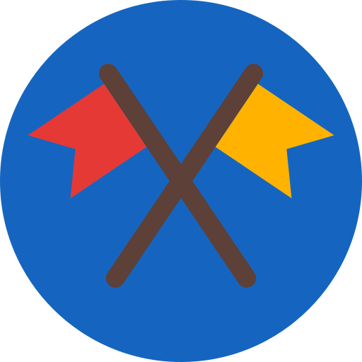
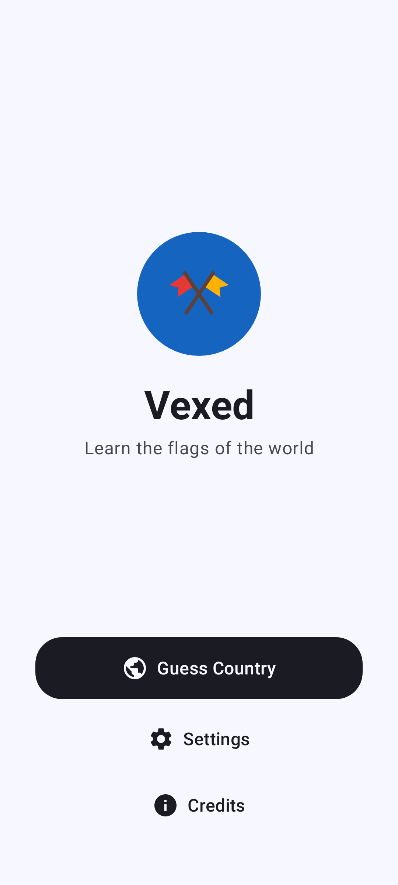

<!-- Generated from readme.yml by LukeNeedham/ci-workflows (docs/readme.md). Edit readme.yml, not this file. -->
<p align="center">
  
</p>

# Vexed

A game for learning the flags of the world.

[Web app](https://lukeneedham.github.io/flagtutor/)

## Description

Vexed is a game for learning the flags of the world. It shows you a flag and you pick the country it belongs to, then
it tells you about the flag: what it symbolises and where the country is on a map. It runs on Android, on iOS and in
the browser, built with Kotlin Multiplatform and Compose Multiplatform.

## Screenshots



## Getting started as a user

1. Install the latest build from the [AppHub](https://www.lukeneedham.com/apphub) app, or download the APK from the [Releases](https://github.com/LukeNeedham/FlagTutor/releases) page.

Requires Android 7.0 (API 24) or newer.

## Getting started as a developer

Requirements: JDK 17 and the Android SDK (platform 36), for example through Android Studio.

```
git clone https://github.com/LukeNeedham/FlagTutor.git
cd FlagTutor
./gradlew assembleDebug    # the APK is in app/build/outputs/apk/debug/
./gradlew test             # unit tests
```

Every pull request is built by CI, which comments on it with a link to install the APK.

Like all my apps, it follows the shared architecture and conventions (single activity, Jetpack Compose, Navigation 3, MVVM with every page split into a `Page` and a `PageContent`, Koin): see [ci-workflows](https://github.com/LukeNeedham/ci-workflows/blob/main/docs/new-app.md).

The countries are the 249 ISO 3166-1 alpha-2 codes, described by one data file, `country_data.json`, which is built
from Wikipedia by `./gradlew generateCountryData` (run by the **Update Country Data** workflow). The flag
descriptions are written by hand and must follow `scripts/FLAG_DESCRIPTION_RULES.md`. See `CLAUDE.md` for the data
and the web target.

The iOS app can only be built on macOS with Xcode: open `iosApp/iosApp.xcodeproj`. The web app is served locally by
`./gradlew :app:wasmJsBrowserDevelopmentRun`.

## Contributing

Branch from `main`, make the change, and open a pull request. CI must be green before it is merged.

## License

All rights reserved. See [LICENSE](LICENSE).
